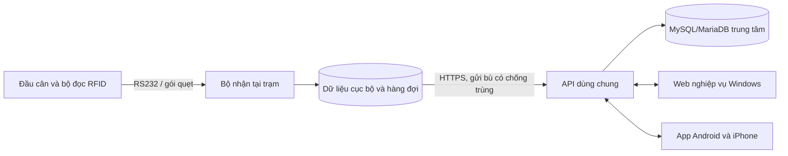

# Rà soát source cân bàn quẹt thẻ và hướng phát triển

Ngày: 17/10/2026. Source: `durian scale V2` trong workspace `qhs-scales-mobile`.

Cập nhật sau đợt sửa: xem [Sửa lỗi và rà soát sau sửa](DURIAN_V2_FIXES_AND_REVIEW.md). Các phát hiện bên dưới mô tả thời điểm rà soát ban đầu.

Tài liệu này là kết quả đọc source và đề xuất triển khai. Chưa sửa chương trình cân, chạy ứng dụng desktop, mở file MDF, kết nối thiết bị, thay đổi database hay triển khai lên hosting.

## 1. Kết luận để quyết định

Nên phát triển cân bàn trong cùng nền tảng Web/App hiện tại, dùng chung quản lý trạm, tài khoản, quyền và API. Tách nghiệp vụ **cân xe tải** và **cân bàn/thu mua** thành hai module; tách chương trình đọc thiết bị tại trạm thành một thành phần riêng.

Source này có giá trị nhất ở giao thức gói quẹt, cách gom lượt theo loại hàng, cấu trúc phiếu/chi tiết/lượt cân và mẫu in. Không nên chuyển nguyên WinForms, kết nối DB trực tiếp và trạng thái toàn cục sang Web/App.

Hướng triển khai đầu tiên: một trạm thử nghiệm dùng Windows nhận RS232, ghi bền vững tại chỗ và gửi API; Web, Android và iPhone xem chung dữ liệu. Giữ khả năng cân tại chỗ khi mất Internet. Sau khi luồng này được kiểm chứng, bổ sung thiết bị gateway độc lập và Bluetooth BLE cho nơi cần cân bằng điện thoại.

## 2. Phạm vi rà soát và mức độ xác minh

- Lập danh mục 225 file nguồn/cấu hình/project dạng văn bản, không tính `.git`, `.vs`, `packages`, `bin`, `obj`. Trong đó 158 file thuộc nhóm ứng dụng/project (21.395 dòng), 66 file Designer/Properties (32.450 dòng), một wrapper SDK (144 dòng). Đây là cách phân loại phục vụ kiểm kê, không phải tỷ lệ code đã kiểm thử.
- Đọc sâu luồng khởi động/đăng nhập, COM/RFID, giải mã gói quẹt, nhập phiếu, tính tiền, lưu/đọc chi tiết, danh mục, in phiếu và các nhánh cân cũ; đối chiếu các màn hình quản trị, báo cáo, import/backup, model và tham chiếu build. Các file Designer, tiện ích lặp lại và thư viện được rà theo cấu trúc, liên kết và điểm sử dụng; không coi đây là kiểm toán từng dòng thư viện.
- `QHS-Weight.csproj` có 210 mục Compile, đều tồn tại ở đường dẫn được tham chiếu. Solution gồm ứng dụng WinForms và thư viện DetectLP. `ConsoleApp1` là khung console chưa có nghiệp vụ.
- Biên dịch riêng **file thật** `Class/ScaleCardProtocol.cs` bằng PowerShell `Add-Type`, chạy chín chuỗi mẫu; kết quả ở `artifacts/durian-source-review/protocol-checks.json`.
- Chưa build toàn solution: `dotnet`/`MSBuild` không có trên PATH trong phiên kiểm tra; hai trong 35 HintPath không tồn tại tại đường dẫn khai báo, gồm OzekiSDK và reference assembly System của .NET Framework 4.6.1. Có 33 reference DevExpress. Chưa kết luận assembly không thể được resolve từ nơi khác; chưa xác minh bản quyền/runtime SDK.
- Chưa kiểm chứng firmware, model đầu cân, loại thẻ, sơ đồ dây, dữ liệu thực tế, schema trong MDF/MySQL hay số liệu đang vận hành. Comment trong code không thay cho xác nhận phần cứng hoặc schema.
- Checkout có nhiều thay đổi và file mới từ trước. Đánh giá dựa trên nội dung hiện có, không chỉ commit Git cũ; không reset hoặc sửa các thay đổi đó.

Danh mục file kèm SHA-256: `artifacts/durian-source-review/source-inventory.csv`. File nhị phân, dữ liệu MDF/LDF, RAR và DLL không được coi là đã đọc nội dung nghiệp vụ.

## 3. Phần mềm hiện có gì?

| Nhóm | Nội dung thấy trong source | Điểm vào chính |
|---|---|---|
| Nền desktop | C# WinForms, .NET Framework 4.6.1, DevExpress 20.1; Dapper và EF6 | `CanQuocHung.sln`, `QHS-Weight.csproj` |
| Dữ liệu | Build thường dùng SQL Server/LocalDB; build có symbol `APP` dùng MySQL cho nhiều đường truy cập | `Class/Global.cs`, `Class/SQLHelper.cs`, `Model/DAL.cs` |
| Tài khoản | `tbusers`, trạm `tbusers_group`, role và quyền theo menu; đăng nhập so sánh MD5 | `GUI/frmLogin.cs`, `GUI/frmMain.cs` |
| Cân bàn mới | Tạo phiếu, quẹt nhiều lượt, gom theo mã loại hàng, đơn giá riêng, tổng kg/tổng tiền | `GUI/frmCans.cs` |
| Nhận gói quẹt | Cổng COM cấu hình ở mục đầu đọc thẻ; đọc ASCII và chuyển tới màn hình cân | `Class/RFID.cs` |
| Giải mã | Loại hàng, mã người quẹt, số kg, số đầu cân trong một chuỗi | `Class/ScaleCardProtocol.cs` |
| Tra tên | Mã loại hàng → tên; mã người quẹt → họ tên, theo trạm | `GUI/frmRFIDWrite.cs`, `tbcan_itemtype`, `tbcan_employee` |
| Phiếu/in | Header → nhóm hàng → từng lượt; mẫu phiếu sầu riêng riêng, lựa chọn mẫu số 7 | `BLL/weightBLL.cs`, `Reports/Phieu/PhieuCanSauRieng*` |
| Nhánh cân khác | Cân tự động, IO/barrier/cảm biến, điểm bột, các cách tính cân thường/tạp chất/bao/mỏ đá/chè | `frmAutoweight`, `clsAuto`, `IODevice`, `weight_type` |
| Camera | Chụp ảnh tới đường dẫn máy tính, lưu metadata đường dẫn/checksum; thư viện nhận biển số Emgu/Tesseract | `CameraHelper`, `DetectLP` |
| Tiện ích cũ | Báo cáo, Excel, nhập JSON, cân thủ công bằng file JSON, backup SQL Server, SQL tool | Các form tương ứng trong `GUI` |

Các chức năng Excel vẫn tồn tại trong source desktop được cung cấp. Việc trước đây đã bỏ Excel/PDF ở App không đồng nghĩa bản desktop này đã được sửa theo. Đợt rà soát này chưa xóa chức năng desktop.

### Luồng cân bàn đang chạy theo code

1. Đăng nhập, xác định tài khoản/trạm, mở COM đầu đọc nếu cấu hình bật.
2. Người vận hành tạo phiếu, chọn khách và mặt hàng; source hiện yêu cầu biển số khi lưu.
3. Nhận chuỗi ví dụ `@typea(1001)+000052*s1#`.
4. Giải mã: loại `a`, người quẹt `1001`, 5,2 kg, đầu cân số 1. Tên chỉ là tra cứu bổ sung; thiếu danh mục vẫn có thể nhận lượt.
5. Thêm lượt vào bộ nhớ của phiếu đang chọn, nhóm theo loại hàng. Một loại có thể đến từ nhiều đầu cân.
6. Người vận hành nhập đơn giá từng loại. Tổng kg = tổng lượt; tổng tiền = tổng của `(kg từng loại × giá loại đó)`.
7. Bấm Lưu: ghi header `tbweight`, sau đó lưu `tbweight_detail` và `tbweight_entry` trong giao dịch riêng.
8. In đọc lại DB, tổng hợp theo loại và dựng mẫu phiếu sầu riêng.

Gói mới đã chứa số kg nên luồng này không cần ghép mã thẻ với một số cân đọc từ cổng khác tại thời điểm quẹt. Tuy nhiên cần xác nhận thiết bị thật đang gửi giao thức này. Các nhánh cũ vẫn dùng `block1=...sn=...`, có ý nghĩa khác.

Trong các đường đã lần theo, build local và build APP chọn một database làm nơi ghi trực tiếp. Chưa thấy cơ chế outbox tự động đồng bộ phiếu/lượt giữa hai nơi. Nhánh cân thủ công lưu JSON rồi nhập lại header là tiện ích riêng, chưa thay thế được đồng bộ cân bàn có chi tiết và chống trùng.

### Những đối tượng không được đánh đồng

| Đối tượng | Ý nghĩa trong bản này |
|---|---|
| `tbusers_group` | Trạm/khách hàng sử dụng phần mềm của Quốc Hưng |
| `tbusers` | Tài khoản đăng nhập phần mềm |
| `tbcustomer` | Khách giao hàng/chủ hàng/nhà cung cấp được chọn trên phiếu; cần giữ khi làm module cân bàn |
| `tbcan_employee` | Danh mục mã người quẹt; không tự động là tài khoản đăng nhập hoặc chủ hàng |
| `tbitems` | Mặt hàng/giống hàng ở đầu phiếu |
| `tbcan_itemtype` | Phân loại/phẩm cấp nhận từ gói thẻ, mã một chữ a–z |
| `tbweight_detail` | Nhóm loại hàng và đơn giá/tổng của nhóm |
| `tbweight_entry` | Từng lượt quẹt: kg, giờ máy tính, người quẹt, đầu cân, raw data |

Tên màn hình `frmRFIDWrite` còn theo cách cũ: phần hiện tại chủ yếu quản lý danh mục loại hàng/người quẹt, không phải luồng ghi lại thẻ vật lý. Source không bao gồm firmware đầu cân/hộp thu để tự thay đổi nội dung phát ra.

## 4. Các việc phải xử lý trước khi mở rộng

Các mức dưới đây là mức ưu tiên cho bản kế tiếp, không khẳng định sự cố đã xảy ra trên thiết bị thật.

| Ưu tiên | Phát hiện và hệ quả | Bằng chứng trong `CanQuocHung` | Việc cần làm |
|---|---|---|---|
| P0 | Bộ nhận ghi đè một kết quả dùng chung; nhiều dòng tới trước lần timer kế tiếp chỉ còn kết quả cuối | `Class/RFID.cs:433`, `GUI/frmCans.cs:1097`, Designer đặt timer 200 ms | Hàng đợi có lưu bền vững; xử lý từng sự kiện, không dùng một cờ/kết quả cuối |
| P0 | Bộ nhận chờ CR/LF, trong khi bộ giải mã nhận gói kết thúc `#`; thiếu xuống dòng sẽ bị giữ lại, nhiều gói dính nhau không parse được | `RFID.cs:444`, `ScaleCardProtocol.cs:57` | Xác minh framing thật; bộ ghép/tách stream có giới hạn buffer, xử lý gói cắt/dính/nhiễu và reconnect |
| P0 | Lượt mới chỉ nằm trong RAM trước khi Lưu; đóng ứng dụng, chuyển phiếu hoặc lỗi có thể mất lượt | `frmCans.cs:373`, `frmCans.cs:935` | Ghi từng sự kiện tại chỗ trước khi thông báo đã nhận; khôi phục nháp khi mở lại |
| P0 | Header và chi tiết không nguyên tử; kết quả lưu chi tiết không được caller kiểm tra, UI có thể reset sau khi header thành công | `frmCans.cs:301`, `frmCans.cs:758` | Giao dịch bao trùm header/nhóm/lượt, chỉ báo thành công khi commit; không kết thúc cân/in khi còn lỗi |
| P0 | Mỗi lần lưu xóa rồi tạo lại toàn bộ chi tiết/lượt; không có version để chống hai người ghi đè | `frmCans.cs:772` | Sự kiện thêm mới giữ ID ổn định; sửa/hủy có audit; kiểm tra version của phiếu |
| P0 | Luồng nhánh desktop có quyền DB trực tiếp và credential dùng chung trong source; cấu hình MySQL tắt SSL | `Class/Global.cs`, `Class/SQLHelper.cs` | Client mới chỉ gọi API; tách bí mật và lập kế hoạch đổi credential phối hợp với các desktop đang dùng |
| P1 | Danh sách hiện tại dùng `GETDATE()` dù build APP chọn MySQL; SQL helper scalar và backup có đường SQL Server riêng | `frmCans.cs:834`, `SQLHelper.cs:303`, `frmBackup.cs:35` | Kiểm tra dialect và schema rõ ràng theo môi trường; không coi `APP` là đã tương thích MySQL hoàn toàn |
| P1 | Danh sách phiếu cũ INNER JOIN `tbweight_type`; phiếu cân bàn không có giá trị khớp sẽ bị loại khỏi danh sách này | `GUI/frmDSCan.cs:55`, so với nhánh in sầu riêng riêng | Danh sách/chi tiết riêng cho cân bàn; không dùng màn sửa cân xe để sửa phiếu cân bàn |
| P1 | Đọc chi tiết lỗi được đổi thành danh sách rỗng, khó phân biệt phiếu không có lượt với lỗi schema/DB | `frmCans.cs:707` | Hiển thị trạng thái không tải được, khóa ghi đè và giữ dữ liệu đã có |
| P1 | Nút giả lập luôn được khởi tạo, đi cùng đường xử lý lượt thật và không đánh dấu dữ liệu thử | `frmCans.cs:1073`, `frmCans.cs:1138` | Chỉ cho phép môi trường thử; môi trường thật chặn dữ liệu mô phỏng |
| P1 | Cấp số phiếu bằng đọc `lastid` rồi tăng; nhiều máy có thể cấp cùng số | `SettingsData.cs:100`, `frmCans.cs:223` | ID kỹ thuật duy nhất; cấp số hiển thị nguyên tử; có quy tắc số offline và mapping về server |
| P1 | Tên loại/khách được tra lại khi in; đổi danh mục có thể làm phiếu cũ hiển thị khác | `BLL/weightBLL.cs:318`, `:441` | Lưu snapshot thông tin và giá lúc chốt; in lại từ bản đã chốt |
| P1 | Đăng nhập MD5, lưu mật khẩu trong INI khi chọn nhớ; còn đường vào cân thủ công bằng mã cố định | `frmLogin.cs`, `SettingsData.cs:406`, `Program.cs` | Chuyển auth sang API với phiên/token, nâng hash có lộ trình tương thích desktop; bỏ đường truy cập bằng mã cố định ở bản mới |
| P1 | Các màn quản trị cũ có truy vấn toàn bộ tài khoản và SQL tool; nhánh xóa dữ liệu local dùng TRUNCATE cả bảng | `frmUsers.cs:30`, `frmSqlTool.cs`, `frmConfigs.cs:341` | Không đưa công cụ này sang UI trạm; quyền và tenant phải kiểm tra ở API; thao tác bảo trì tách riêng |

Một số comment đã lệch code: có comment nói không có source RFID hoặc mã vùng trồng chưa lưu, nhưng file RFID đang có và `ma_vung_trong` đang được bind/map và dùng khi in. Chưa có bằng chứng schema DB thực tế đã có đầy đủ cột này. Các câu ALTER TABLE trong comment chỉ là gợi ý, không phải migration đã được áp dụng.

### Kết quả thử bộ giải mã

- Chuỗi mẫu 5,2 kg: đúng; chữ loại viết hoa được đổi thường; mã người quẹt một chữ số được đệm thành bốn số.
- Parser chấp nhận số âm và 0; handler cân mới loại các giá trị `<= 0`.
- Parser chấp nhận đầu cân `0` và `99`; chưa xác thực danh sách đầu cân được đăng ký. Cần dùng cấu hình thiết bị thật, không hardcode chỉ ba đầu cân và cũng không mặc định mọi số đều hợp lệ.
- Hai gói nối liền thành một chuỗi bị từ chối; chuỗi block/SN cũ cũng bị parser mới từ chối.
- Chín chuỗi trên là kiểm tra bộ giải mã, không phải bằng chứng đã kiểm tra toàn bộ luồng cổng COM hoặc cân thật.

## 5. Kiến trúc cụ thể đề xuất

### Thành phần triển khai

| Thành phần | Hướng chọn | Trách nhiệm |
|---|---|---|
| Backend hiện tại | Mở rộng Express/TypeScript, giữ DB tương thích MySQL/MariaDB | Auth, tenant, phiếu, thiết bị, đồng bộ, audit, báo cáo |
| Mobile hiện tại | Giữ Expo/React Native; thêm module Cân bàn | Xem/điều khiển theo quyền, theo dõi ca/lô, nhật ký lượt và trạng thái đồng bộ |
| Web nghiệp vụ | Thêm giao diện bàn cân trong cùng workspace; tái dùng API/types | Màn thao tác rộng cho máy tính; không ép giao diện quản trị và thao tác cân thành một màn |
| Bộ nhận Windows | C#; tách parser/transport khỏi DevExpress, EF, camera và Global | Sở hữu cổng COM, nhật ký bền vững, phiên làm việc, retry, trạng thái thiết bị; chạy độc lập màn hình |
| Lưu tại trạm | SQLite cho bộ nhận mới; desktop cũ giữ DB của nó trong giai đoạn chuyển tiếp | Sự kiện/phiếu nháp/giá đã chốt, outbox, khôi phục sau restart |
| Gateway độc lập | Giai đoạn sau, chọn qua thử nghiệm phần cứng | Phục vụ điểm không có Windows, ưu tiên mạng Ethernet/Wi-Fi; BLE là đường bổ sung |

Đây là thiết kế đề xuất, chưa tạo các thành phần mới. Không bắt buộc dùng SQLite thay DB đang chạy trong desktop cũ.

### Quy tắc để không gán nhầm phiếu

Gói hiện tại **không có mã phiếu, mã khách, phiên làm việc, thời gian thiết bị hay số thứ tự sự kiện**. Khi có nhiều Web/App cùng mở, không thể lấy "phiếu đang chọn trên một màn hình" làm quy tắc chung.

- Đăng ký bộ nhận với đúng trạm bằng credential thiết bị riêng; API suy ra trạm từ credential, không tin trạm do client tự gửi.
- Mỗi đầu cân tại một thời điểm gắn với một phiên/phiếu đang nhận, có người vận hành chịu trách nhiệm. Nếu nhiều đầu cân gom vào một phiếu, cấu hình liên kết đó rõ ràng.
- Chuyển phiếu phải có ranh giới nhận lượt rõ ràng tại bộ nhận: hoàn thành/giữ các lượt cũ trước khi chuyển, có xác nhận cấu hình phiên mới đã được áp dụng.
- Nhiều máy được xem; quyền nhận/chuyển phiên chỉ một bên sở hữu tại một thời điểm. Khóa có version/lease; tránh tự chuyển chủ khi bộ nhận đang offline chưa đối soát.
- Mã người quẹt trong gói không đủ để chứng minh quyền đăng nhập hoặc tự xác định chủ hàng.

### Chống trùng và giới hạn của phần cứng

Ghi sự kiện có UUID ngay tại nơi nhận, dùng lại UUID khi gửi bù. API đặt unique theo nguồn thiết bị/sự kiện và xử lý nguyên tử để retry không cộng lại số kg/tiền.

UUID này giải quyết **gửi lại qua mạng**, chưa phân biệt được hai lần firmware phát lại cùng một lượt với hai lượt thật có cùng số kg. Không dùng hash chuỗi thô làm khóa chống trùng vĩnh viễn: hai lượt hợp lệ có thể giống hệt chuỗi.

Nên bổ sung firmware `device_id`, `event_seq`, thời điểm, đơn vị, cờ ổn định và kiểm tra toàn vẹn/ACK nếu phần cứng cho phép. Nếu hộp thu chỉ phát một chiều, phải ghi rõ mức đảm bảo: chương trình không thể xác nhận hồi tố lượt đã mất trước khi ghi bền vững; cũng không suy ra được số cân ổn định từ gói không có thông tin đó.

### Bluetooth và cân bằng điện thoại

Source này đang làm việc với COM, chưa có triển khai Bluetooth native cho Android/iPhone. Nếu thiết bị phát đúng gói quẹt, có thể giữ hợp đồng dữ liệu và thay transport, nhưng phải ghép gói qua các lần nhận BLE, không coi một notification là một lượt.

- Ưu tiên bộ chuyển RS232–BLE có thông số GATT, notification và điều kiện nguồn rõ ràng; thử cùng đầu cân/hộp thu thật trước khi chọn sản phẩm.
- Web Bluetooth dùng BLE/GATT trên trình duyệt hỗ trợ, yêu cầu secure context và thao tác cấp quyền. Không dùng giả định "mọi trình duyệt đều kết nối được". [Chrome](https://developer.chrome.com/docs/capabilities/bluetooth)
- Với iPhone, kiểm tra đúng giao thức/phụ kiện qua các API Apple hỗ trợ; không cam kết module ghi chung "Bluetooth" sẽ tương thích. [Apple Bluetooth](https://developer.apple.com/bluetooth/)
- App Expo cần development build khi dùng thư viện native không có sẵn trong Expo Go. [Expo](https://docs.expo.dev/develop/development-builds/introduction/)
- Khi điện thoại trực tiếp nhận cân, điện thoại là bộ nhận cho phiên đó: phải lưu bền vững, xử lý mất kết nối, đổi thiết bị nhận và vòng đời app. Kiểm thử khóa màn hình/ra nền bằng thiết bị thật trước khi đưa vào vận hành.

### Hosting

Giữ hosting website giới thiệu nếu đáp ứng công việc hiện tại. `phpMyAdmin` chỉ cho biết cách quản lý MySQL, chưa xác định quyền chạy Node/service hay tài nguyên của gói hosting.

API mới cần nơi chạy Node ổn định, HTTPS, tự khởi động lại, giám sát và backup; ưu tiên VPS hoặc dịch vụ ứng dụng có quản lý sau khi đo nhu cầu. Có thể giữ MySQL hiện tại trong giai đoạn chuyển tiếp nếu đủ kết nối, backup, độ trễ và quyền; không cần chuyển hệ DB chỉ để hỗ trợ Bluetooth.

Chỉ đồng bộ lượt đã nhận/chốt và trạng thái cần thiết; không đưa mọi mẫu cân liên tục vào DB trung tâm. Khi mất Internet, cân/in tại chỗ tiếp tục theo cấu hình đã lưu; màn hình từ xa phải hiển thị thời điểm cập nhật cuối và trạng thái offline. Giao diện Web điều khiển qua cloud sẽ không có lệnh mới khi đường cloud mất; muốn Web vẫn thao tác tại chỗ phải triển khai thêm đường phục vụ cục bộ có xác thực/HTTPS và kiểm thử riêng.

## 6. Dữ liệu và API cần thêm

Không chuyển nguyên ba bảng desktop vào DB đang chạy rồi coi như hoàn tất tích hợp. Đề xuất bảng mới có prefix `bench_`; tên và DDL sẽ chốt sau khi đọc schema thật trên bản sao.

Khi nhập dữ liệu lịch sử, giữ khóa nguồn gồm trạm, bộ dữ liệu nguồn và ID cũ, vì các máy local có thể trùng ID số nguyên. Phiếu/nhóm cũ thiếu `item_type` cần quy tắc mapping có bằng chứng; không tự gán từ số đầu cân theo giao thức mới. Chạy đối soát số phiếu, số lượt, kg và tiền theo trạm/ngày trước khi chuyển quyền ghi. Giữ nguyên raw data và các cột cũ phục vụ kiểm tra.

| Nhóm | Dữ liệu tối thiểu |
|---|---|
| Thiết bị | Trạm, bộ nhận, mã đầu cân, protocol version, trạng thái kết nối/lần nhận cuối |
| Phiếu `bench_receipts` | UUID, số hiển thị, trạm, người tạo, khách/chủ hàng, hàng/giống, lô, vùng trồng, phiên bản, trạng thái |
| Lượt `bench_entries` | UUID ổn định, phiếu/phiên, thiết bị/đầu cân, người quẹt, loại hàng, kg/đơn vị, raw frame, giờ nhận/giờ server, trạng thái hủy và lý do |
| Giá/nhóm | Giá từng loại trong phiếu và bản snapshot khi chốt; số lượt, tổng kg/tổng tiền do server tính |
| Danh mục | Mã loại theo trạm, mã người quẹt, khách/chủ hàng; mã chưa biết vẫn lưu nguyên để đối soát, không tự bỏ lượt |
| Đồng bộ/audit | Outbox tại chỗ, ID nguồn cũ, mốc đồng bộ, lịch sử chuyển trạng thái và chỉnh sửa |

Trạng thái đề xuất: `nháp/đang nhận → chốt → hủy theo quyền`; trạng thái `chưa gửi/đã gửi/lỗi đồng bộ` theo dõi riêng. Không dùng `weight_2 IS NULL` để xác định phiếu cân bàn chưa hoàn thành.

Phép tính dùng decimal, quy định rõ độ chính xác kg và cách làm tròn tiền. Trước khi thêm bì phải xác nhận số kg trong gói là gross hay net và đầu cân đã trừ bì hay chưa, tránh trừ hai lần. Lưu giá theo phiếu/loại; việc đổi bảng giá mới không được tự đổi phiếu đã chốt.

Các API đề xuất:

- Ghép cặp/cấp quyền bộ nhận, gửi heartbeat và cập nhật cấu hình theo version.
- Tạo phiếu, giao/nhận quyền phiên, gán đầu cân vào phiên.
- Nhận batch sự kiện với kết quả từng sự kiện: đã nhận, đã tồn tại, hoặc lỗi cần xử lý. Xác thực trạm/thiết bị, loại/đơn vị, phiên và quyền tại server; giữ sự kiện không định tuyến được để đối soát.
- Đọc danh sách/chi tiết phân trang, nhật ký lượt, tổng theo loại/người quẹt/đầu cân.
- Cập nhật giá/chốt/hủy có version và audit. Server tự tính số kg và tiền, không tin tổng client.
- Đọc dashboard theo module, ngày, trạm; thông báo cập nhật để Web/App tải phần thay đổi.

Mọi tài khoản thuộc trạm được xem toàn bộ dữ liệu trạm như yêu cầu mới nhất; quyền cân, đổi giá, sửa/hủy và quản lý thiết bị cấp riêng. Tài khoản admin hệ thống vẫn theo chính sách đã xác nhận của dự án hiện tại, không suy từ mã người quẹt hoặc mọi desktop role có tên Admin.

### Tương thích App hiện tại

`backend/src/routes/reports.ts` đang cộng `SUM(w.price_total)` vào `revenue`, và đếm `weight_2 IS NULL` vào `pending`; `utils/weighings.ts` đọc `customer_name/items_name` trực tiếp từ header. Source desktop này lại join tên từ danh mục và có cấu trúc phiếu cân bàn khác.

Vì vậy cần adapter đọc dữ liệu cũ và phân loại nghiệp vụ có nguồn rõ ràng. Không suy loại phiếu chỉ từ việc có/không có `weight_2`; không gán toàn bộ dữ liệu lịch sử thiếu nhãn sang một module bằng phỏng đoán.

Dashboard nên tách: phí dịch vụ cân, giá trị hàng thu mua, tiền đã trả/còn nợ, khối lượng, số lượt, số phiếu và số khách trong phạm vi kỳ. Source hiện chưa có sổ thu/chi hoặc thanh toán nên tổng giá trị phiếu chưa chứng minh doanh thu, tiền thu thực tế hay lợi nhuận.

## 7. Kế hoạch triển khai theo đầu ra có thể nghiệm thu

| Giai đoạn | Công việc | Điều kiện hoàn thành |
|---|---|---|
| 0. Chốt bản nền | Đóng gói source hiện tại, ghi dependency/license/kiến trúc DLL; build cách ly; lấy schema và bản sao dữ liệu thử; ghi mẫu COM thật của từng luồng mới/cũ | Chạy được bản nền trên DB thử, cân/in đối chiếu được; có mẫu CR/LF/#, split/concat, model/baud và sơ đồ kết nối đã xác nhận |
| 1. Làm chắc việc nhận lượt | Tách stream decoder và hàng đợi bền vững; khôi phục nháp; chặn simulator; sửa lưu nguyên tử và lỗi đọc; chốt quy tắc giá/bì/trạng thái | Replay 1.000 gói hợp lệ cho ra đúng 1.000 lượt; cắt/dính gói không mất/nhân lượt; restart còn nháp; lỗi DB không báo lưu xong; hai phiên không ghi đè nhau |
| 2. Tích hợp API cân bàn | Migration bổ sung trên bản sao; thiết bị theo trạm, receipt/entry, outbox/idempotency, audit; adapter dữ liệu cũ và dashboard tách module | Cùng batch gửi lại nhiều lần không tăng tổng; hai trạm không đọc/ghi chéo; đối soát header/nhóm/lượt và giá trị trước/sau chuyển đổi |
| 3. Web/App dùng thực tế | Web thao tác bàn cân; App xem ca/lô/loại/người quẹt và cảnh báo; hiển thị trạng thái kết nối/đồng bộ; in từ bản chốt | Windows, Android, iPhone cùng thấy một phiếu và đúng tổng; quyền thao tác đúng; mất Internet vẫn cân tại chỗ và gửi bù đúng sau phục hồi |
| 4. Bluetooth và mở rộng | Thử BLE/gateway không PC, app nhận trực tiếp; xử lý khóa màn hình, đổi máy, hết pin, reconnect | Qua kiểm thử phần cứng thật trên cả ba nền tảng và ca vận hành thử; công bố rõ thiết bị/OS được hỗ trợ |
| 5. Quản lý thu mua | Bì/bao, phẩm cấp, bảng giá theo ngày, thanh toán/công nợ, chốt ca, đối soát, cảnh báo | Mỗi thay đổi có quy tắc nghiệp vụ và số liệu đối soát riêng, không chỉ thêm ô nhập |

Không chạy hai chương trình cùng chiếm một COM trong pilot. Hoặc harden receiver ngay trong desktop rồi tách dần, hoặc chuyển quyền sở hữu COM sang agent và để desktop nhận qua agent. Giai đoạn chuyển tiếp không để cả desktop và API tự ghi cùng một lượt; cần nguồn ghi chính và mapping ID nguồn.

Trước khi chuyển trạm thật: có bản sao phục hồi đã thử, tiêu chí đối soát, khả năng quay lại bản cũ và phân biệt rõ lượt đã được hai hệ nhận. Không sửa/drop bảng lịch sử chỉ theo comment trong model.

**Phạm vi bản đầu nên làm:** một trạm, giao thức hiện tại, nhận lượt không mất sau khi đã lưu tại chỗ, phiếu theo loại/đơn giá, đồng bộ có chống trùng, Web/App xem chi tiết. Các phần Bluetooth trực tiếp, công nợ, cân bì và tự động IO đưa vào các giai đoạn sau để nghiệm thu độc lập.
